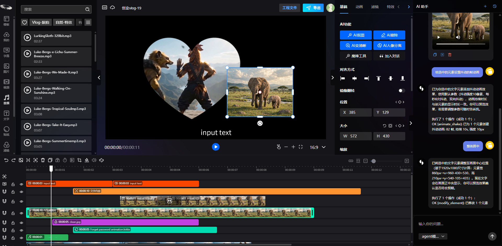

# VidCut

<div align="center">

<h3>Modern, Open-Source & AI-Free Browser Video Editor</h3>
<p>Éditeur Vidéo Web Moderne, Léger et Sans IA | محرر فيديو متقدم ومفتوح المصدر داخل المتصفح بدون ذكاء اصطناعي</p>

<p>
  <a href="#english">English</a> •
  <a href="#français">Français</a> •
  <a href="#العربية">العربية</a>
</p>

<p>
  <a href="https://github.com/walidroid/vidcut"></a>
  
  
  
  
  
  
</p>



</div>

---

<a name="english"></a>
## 🇬🇧 English

### Overview

**VidCut** is a high-performance, open-source web-based video editor built for creators and developers who want a desktop-grade editing experience directly in modern web browsers.

Unlike heavy, bloated alternatives, **VidCut is completely stripped of artificial intelligence (AI) bloatware, external tracking, and cloud lock-in**. It runs client-side using WebGL, Web Workers, WebCodecs, and FFmpeg WebAssembly, providing blazing-fast editing while keeping all your source files securely on your local computer.

### Key Features

- **Multi-Track Timeline**: Mix video, audio, text, images, subtitles, stickers, and effect layers with precise frame snapping, slicing, dragging, and trimming.
- **Real-Time WebGL Canvas**: Hardware-accelerated WYSIWYG playback powered by PixiJS and WebGL shaders.
- **Keyframe Animation Engine**: Custom keyframes for position, scale, rotation, opacity, and bezier motion paths.
- **Visual Effects & Transitions**: GL Transitions, LUT color filters, chroma key (green screen), layer blending modes, and shapes masking.
- **Comprehensive Audio Editing**: Waveform visualization, volume envelopes, speed ramping, and fade in/out curves.
- **Rich Typography & Subtitles**: Dedicated subtitle track with styling (fonts, strokes, shadows, gradients, and per-word animations).
- **Client-Side Export**: High-speed local rendering using WebCodecs, MP4 Muxer, and FFmpeg WASM without uploading videos to remote servers.
- **Local File System Integration**: Direct read/write to your chosen local folder via the File System Access API and Dexie/IndexedDB.
- **Clean & Private**: No AI models, zero tracking analytics, and clean localization (English & French).

### Tech Stack

| Domain | Technology |
| --- | --- |
| **Framework & UI** | React 18, TypeScript, Semi Design, Less |
| **State Management** | MobX |
| **Canvas & Graphics** | PixiJS, WebGL, GL Transitions, Three.js |
| **Media Processing** | FFmpeg WASM, WebCodecs, MP4 Muxer, Howler.js, Web Workers |
| **Local Storage** | File System Access API, IndexedDB (Dexie) |
| **Build & Tooling** | Vite 4, Terser |

### Quick Start

#### Requirements
- Node.js 18+ (LTS recommended)
- Yarn package manager (`npm install -g yarn` or `npx yarn`)
- Chromium-based browser (Google Chrome, Microsoft Edge, Brave, Opera) for File System Access API & WebCodecs support

#### Installation

```bash
# Clone the repository
git clone https://github.com/walidroid/vidcut.git
cd vidcut

# Install dependencies
yarn install

# Start development server
yarn dev
```

Visit the local server in your browser (usually `http://localhost:3005`).

#### Production Build

```bash
# Build worker bundles and production assets
yarn build:worker
yarn build

# Preview production build locally
yarn preview

# Package standalone Windows Installer (.exe)
yarn dist:win
```

> **Note**: Windows `.exe` installers are also automatically built and available for download in **GitHub Actions** artifacts and Releases.

---

<a name="français"></a>
## 🇫🇷 Français

### Présentation

**VidCut** est un éditeur vidéo web open-source et performant, conçu pour offrir une expérience de montage digne d'un logiciel de bureau directement dans votre navigateur web.

Contrairement aux alternatives surchargées, **VidCut a été entièrement épuré de tout module d'intelligence artificielle (IA), de télémétrie et de dépendances cloud inutiles**. Le traitement s'effectue intégralement côté client grâce à WebGL, aux Web Workers, à WebCodecs et à FFmpeg WebAssembly, garantissant une fluidité maximale et une confidentialité absolue de vos fichiers médias.

### Fonctionnalités Principales

- **Timeline multi-pistes** : Gestion fluide et combinée de pistes vidéo, audio, texte, images, sous-titres et effets avec aimantation temporelle, découpe et redimensionnement précis.
- **Canvas WebGL en temps réel** : Rendu interactif WYSIWYG accéléré matériellement grâce à PixiJS et aux shaders WebGL.
- **Système d'images clés (Keyframes)** : Animation détaillée de la position, de l'échelle, de la rotation, de l'opacité et de trajectoires personnalisées en courbes de Bézier.
- **Effets et transitions visuelles** : Transitions GL haute performance, filtres de couleur LUT, incrustation sur fond vert (Chroma Key), modes de fusion et masques de forme.
- **Édition audio complète** : Visualisation des formes d'onde, réglage des niveaux sonores, courbes de fondu (fade in/out) et modification de la vitesse de lecture.
- **Typographie et sous-titres** : Piste de sous-titres dédiée avec personnalisation avancée des polices, contours, ombres et dégradés.
- **Exportation 100% locale** : Rendu rapide dans le navigateur via WebCodecs, MP4 Muxer et FFmpeg WebAssembly, sans jamais envoyer vos fichiers vers un serveur distant.
- **Stockage local direct** : Sauvegarde dans un répertoire local de votre choix via la File System Access API et persistance des métadonnées dans IndexedDB.
- **Confidentialité et légèreté** : Zéro modèle IA lourd, aucun script de pistage, interface bilingue (Français et Anglais).

### Technologies Utilisées

| Domaine | Technologie |
| --- | --- |
| **Interface & Framework** | React 18, TypeScript, Semi Design, Less |
| **Gestion d'état** | MobX |
| **Moteur graphique & Rendu** | PixiJS, WebGL, GL Transitions, Three.js |
| **Traitement multimédia** | FFmpeg WebAssembly, WebCodecs, MP4 Muxer, Howler.js, Web Workers |
| **Stockage & Fichiers** | File System Access API, IndexedDB (Dexie) |
| **Outils de compilation** | Vite 4, Terser |

### Démarrage Rapide

#### Prérequis
- Node.js 18 ou version supérieure (LTS recommandée)
- Gestionnaire de paquets Yarn (`npm install -g yarn` ou `npx yarn`)
- Navigateur basé sur Chromium (Google Chrome, Microsoft Edge, Brave) pour le support complet de la File System Access API

#### Installation et Exécution

```bash
# Cloner le dépôt
git clone https://github.com/walidroid/vidcut.git
cd vidcut

# Installer les dépendances
yarn install

# Lancer le serveur de développement
yarn dev
```

Ouvrez l'adresse indiquée par votre terminal (par défaut `http://localhost:3005`).

#### Compilation pour la Production

```bash
# Compiler les workers et l'application
yarn build:worker
yarn build

# Prévisualiser la version de production
yarn preview

# Créer l'exécutable d'installation Windows (.exe)
yarn dist:win
```

> **Note** : Les installeurs Windows `.exe` sont également générés et téléchargeables automatiquement via **GitHub Actions** (Artéfacts et Releases).

---

<a name="العربية"></a>
## 🇸🇦 العربية

<div dir="rtl">

### نظرة عامة

**VidCut** هو محرر فيديو احترافي مفتوح المصدر وعالي الأداء، صُمم ليوفر تجربة مونتاج سينمائية قوية ومماثلة للبرامج المكتبية مباشرة داخل متصفح الويب الخاص بك، ودون الحاجة لتثبيت أي برامج إضافية.

بخلاف البرامج المعقدة والمثقلة بالخدمات غير الضرورية، **تم تجريد VidCut بالكامل من أدوات الذكاء الاصطناعي (AI) الثقيلة، ومن برمجيات التتبع، وبدون أي تبعية لخوادم سحابية خارجية**. تعمل المنصة بشكل كامل على جانب العميل (Client-Side) بالاعتماد على تقنيات WebGL و Web Workers و WebCodecs و FFmpeg WebAssembly، مما يوفر سرعة معالجة فائقة وأماناً مطلقاً لملفاتك ومشاريعك التي تبقى دائماً على جهازك الشخصي.

### أبرز المميزات

- **خط زمني متعدد المسارات (Multi-Track Timeline)**: دمج وترتيب مسارات الفيديو، الصوت، الصور، النصوص، الملصقات والتأثيرات مع أدوات دقيقة للقص، التمديد، التقسيم، والتحريك المتزامن.
- **معاينة حية وفورية عبر WebGL**: شاشة عرض متقدمة مدعومة بتسريع العتاد عبر PixiJS ومظللات WebGL الفورية.
- **محرك الإطارات المفتاحية (Keyframes)**: إنشاء رسوم متحركة دقيقة للموضع، الحجم، الدوران، الشفافية، ومسارات الحركة المنحنية (Bézier Curves).
- **مؤثرات وانتقالات بصرية احترافية**: مجموعة انتقالات سينمائية (GL Transitions)، فلاتر ألوان LUT، إزالة الخلفية الخضراء (Chroma Key)، وأقنعة الأشكال الهندسية.
- **أدوات صوتية متكاملة**: تمثيل مرئي للموجات الصوتية (Waveforms)، تحكم دقيق بمستويات الصوت، وتطبيق تأثيرات التلاشي تدريجياً (Fade in/out) مع تسريع أو إبطاء الصوت.
- **نصوص وعناوين فرعية متقدمة**: مسار مخصص للترجمة والعناوين مع دعم كامل للخطوط، الظلال، الحدود، والتدرجات اللونية.
- **تصدير محلي مباشر فائق السرعة**: معالجة وتصدير الفيديو داخل المتصفح عبر WebCodecs و MP4 Muxer و FFmpeg WASM دون الحاجة إلى رفع أي بيانات لخوادم خارجية.
- **تكامل مباشر مع نظام الملفات المحلي**: حفظ المشاريع والوسائط مباشرة في مجلدك المفضل عبر واجهة File System Access API وقواعد بيانات IndexedDB السريعة.
- **خصوصية وأداء عالي**: خالٍ تماماً من حزم الذكاء الاصطناعي الثقيلة، بدون أي تتبع للإعلانات، مع واجهة مستخدم واضحة وسريعة.

### البنية التقنية

| المجال | التقنيات المستخدمة |
| --- | --- |
| **واجهة المستخدم وهيكل التطبيق** | React 18, TypeScript, Semi Design, Less |
| **إدارة الحالة العامة** | MobX |
| **الرسوميات والعرض المرئي** | PixiJS, WebGL, GL Transitions, Three.js |
| **معالجة الوسائط المتعددة** | FFmpeg WebAssembly, WebCodecs, MP4 Muxer, Howler.js, Web Workers |
| **التخزين المحلي للملفات** | File System Access API, IndexedDB (Dexie) |
| **أدوات البناء والتحزيم** | Vite 4, Terser |

### البدء السريع

#### المتطلبات الأساسية
- بيئة تشغيل Node.js إصدار 18 فما فوق (يُفضل إصدار LTS).
- مدير الحزم Yarn (`npm install -g yarn` أو تشغيله عبر `npx yarn`).
- متصفح ويب حديث يعتمد على محرك Chromium (مثل Google Chrome، Microsoft Edge، Brave) لدعم واجهة File System Access و WebCodecs.

#### التثبيت والتشغيل

```bash
# استنساخ المستودع
git clone https://github.com/walidroid/vidcut.git
cd vidcut

# تثبيت الحزم والاعتماديات
yarn install

# تشغيل خادم التطوير المحلي
yarn dev
```

افتح الرابط الظاهر في الطرفية داخل متصفحك (غالباً `http://localhost:3005`).

#### بناء النسخة الإنتاجية (Production Build)

```bash
# بناء حزم معالجة الوسائط الخلفية والتطبيق
yarn build:worker
yarn build

# معاينة النسخة الإنتاجية محلياً
yarn preview

# بناء برنامج التثبيت لنظام ويندوز (.exe)
yarn dist:win
```

> **ملاحظة**: يتم أيضاً إنشاء ملفات التثبيت لنظام ويندوز (`.exe`) تلقائياً وتوفيرها للتنزيل المباشر عبر **GitHub Actions**.

</div>

---

<div align="center">
  <p><strong>VidCut</strong> • Fast, Lightweight & Privacy-Focused Video Editing in the Browser</p>
  <p><a href="https://github.com/walidroid/vidcut">https://github.com/walidroid/vidcut</a></p>
</div>
